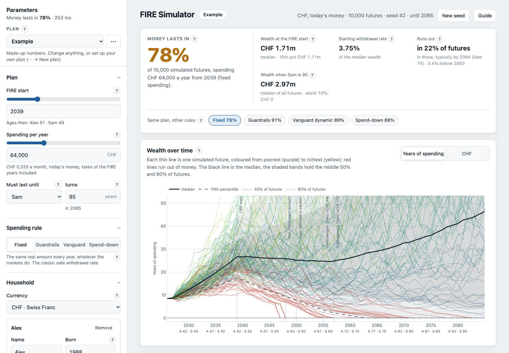
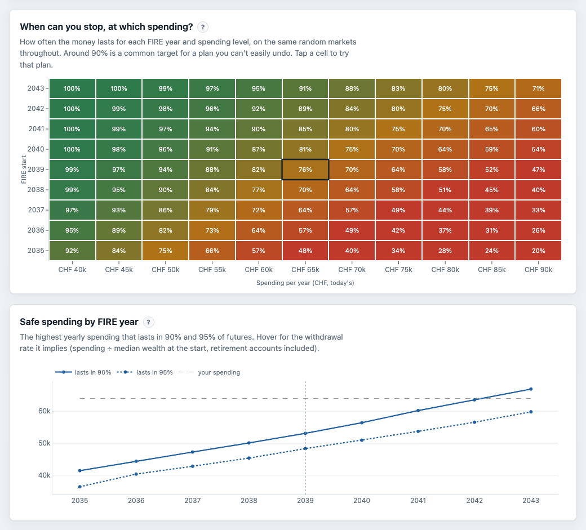

# FIRE Simulator

[](https://github.com/gabriardi/fire-simulator/actions/workflows/test.yml)

**When can you stop working, and how much can you spend once you do?**

A Monte Carlo simulator for FIRE plans (financial independence, retire early). It plays out
thousands of possible futures for your savings, retirement accounts and pensions, then tells you
how often the money lasts. Everything runs in your browser, and nothing you type leaves your
device.

Use it at **[whencanistop.fyi](https://whencanistop.fyi)**, or [run your own copy](#run-it-locally).



- **Static and free to host.** Plain HTML, CSS and JavaScript, with no build step, no server and
  no dependencies. Put the folder on any static host.
- **Local first.** Plans are saved in your browser. You can export them to a file, or send one to
  someone as a link.
- **Made for any household.** One to four people, any currency, any pension system.

## Contents

- [What it answers](#what-it-answers)
- [What you can model](#what-you-can-model)
- [Using it](#using-it)
- [Your data stays with you](#your-data-stays-with-you)
- [Run it locally](#run-it-locally)
- [Deploy your own copy](#deploy-your-own-copy)
- [How the simulation works](#how-the-simulation-works)
- [Assumptions and limits](#assumptions-and-limits)
- [Development](#development)
- [Support](#support)
- [License](#license)

## What it answers

| Question | Where to look |
| --- | --- |
| Will the money last until the end? | **Money lasts in**: the share of futures where it never runs out |
| When could I stop, and at what spending? | **The grid**: FIRE year × yearly spending, the success rate in every cell |
| How much can I safely spend? | **Safe spending by FIRE year**: the highest spending that lasts in 90% and 95% of futures |
| What if the markets crash right after I stop? | **Stress test**: 2008, 2000–2002 and a lost decade, forced into the first FIRE years |
| What does being flexible buy me? | **Same plan, other rules**: the success rate of each spending rule, side by side |
| How bad do the bad futures get? | **Wealth over time**, plus the spread of wealth at the start and of the year the money runs out |



## What you can model

- **Household**: one to four people with their birth years, and the currency (CHF unless you pick
  another). The plan runs until one of them
  reaches an age you choose (95 by default). Charts label the years with everyone's age.
- **Money**: investments, cash, and what you save each year until you stop. Savings can grow
  faster than inflation, for example with raises. You can also keep a few years of spending in cash
  at the FIRE start.
- **Retirement accounts you can't touch yet**, up to 12. Think of a 401(k), an IRA, a personal
  pension, a Swiss pillar 2 or 3a, or a German Riester. Each account has:
  - an owner, a balance and a yearly contribution;
  - an unlock age, when the account is paid out into the portfolio;
  - a flat withdrawal tax;
  - growth either like the portfolio or at a fixed interest.
- **Income and costs after you stop**, up to 12 lines. Examples are state pensions, part-time
  work, rent coming in, or a mortgage going out.
  - Each line starts and stops by calendar year, by someone's age, or by years after the FIRE
    start.
  - A line can be fixed in nominal terms, so inflation erodes it, like an unindexed pension or a
    fixed-rate mortgage.
- **One-off events**, up to 20: an inheritance, a house sale, a new roof or a car. Each happens
  in its year, before or after you stop.
- **Spending rules**:
  - **fixed**, the classic safe withdrawal rate;
  - **Guyton-Klinger guardrails**;
  - **Vanguard dynamic spending**;
  - **spend-down**, or "die with zero".

  The flexible rules have a floor and a ceiling, and are explained [below](#spending-rules).
- **Markets**:
  - a stock/bond mix, with an optional **bond tent** that holds more bonds around the FIRE start;
  - stock and bond returns, volatilities and their correlation;
  - inflation, and an effective tax rate on portfolio withdrawals;
  - **fat tails**, for more frequent extreme years;
  - your own crash sequence for the stress test.

Every input and every chart has a **?** that explains what it means and how to choose a value.
The **Guide** button shows all the explanations in one place.

## Using it

1. **Open it.** A made-up household, Alex and Sam, shows what the simulator does. Nothing about
   them is real.
2. **Set up your plan.** The *Set up my plan* button asks for the essentials: who is in the
   household, the currency, what you have, what you save, what you'd spend, and when you'd like to
   stop. It also asks about state pensions. Everything else starts from sensible defaults.
3. **Fill in the rest** in the left panel: retirement accounts, other income, events, markets.
   Results update as you type.
4. **Save.** *Save* keeps the plan in this browser. *⋯ → Save as a copy* keeps a variant next
   to it, such as "Stop at 50" or "Cautious returns". The plan bar marks unsaved changes, and
   *Revert* discards them.
5. **Back it up.** *⋯ → Export plans* downloads all your plans as one file.

Tips for reading the results:

- **Aim for about 90%** with a plan you can't easily undo. 100% would mean saving for a
  catastrophe that might never come.
- **Try a cautious case.** The stock return moves the answer more than any other input.
  6% nominal with 2% inflation is about 3.9% real, near the middle of long-run forecasts for world
  stocks.
- **Run the stress test.** A crash in the first years after you stop does far more damage than the
  same crash twenty years later.
- **Compare the rules.** If you could cut spending by 10–20% in bad years, a flexible rule often
  lets you stop years earlier.
- **Click a cell in the grid** to try that FIRE year and spending.

Numbers can be typed in the format you're used to: `1,234,567`, `1.234.567`, `1'234'567` or
`1 234 567`, depending on the number format you pick. You can also type `250k` or `1.5M`.

## Your data stays with you

There is no account, no server-side code, no analytics and no request to anyone else. Even the
chart library is served with the site, and a strict Content-Security-Policy (`_headers`) stops the
page from loading anything from elsewhere.

- **Saved plans** live in your browser's local storage, on this device only, and for this web
  address: the same site at another address keeps a list of its own. Browsers can clear that
  storage:
  - when you clear the browsing data, or close a private window;
  - in Safari, after 7 days of use without a visit to the site, unless you added it to the Home
    Screen;
  - in some browsers, when the device runs low on space.

  On the first save, the page asks the browser to keep its storage for good. That covers the
  low-space case. Until an exported file holds your latest saves, a note under the plan reminds
  you to export. The page also warns you when the browser isn't keeping what it saves at all.
- **Export plans** downloads every plan as a JSON file. That file is your backup, and also the way
  to move plans to another device or browser.
- **Import plans** adds a file's plans to the ones already there, and never replaces anything.
- **Share link** (*⋯ → Share link*) packs one plan into the link itself: the plan is compressed
  and placed after the `#`. Browsers don't send that part of a link to the server, so the plan
  isn't uploaded anywhere. Anyone with the link can see the plan's numbers, though, so share it
  like you'd share the numbers themselves. Opening a share link asks first, then adds the plan
  next to yours. Your own plans stay as they are. Opening a link whose plan is already saved
  (a bookmark, or your own link) goes to that plan instead of adding a copy.
- The link also carries the sharer's **seed and number of futures**, as information. If the
  person opening it uses others, a note under the plan says the numbers can differ a little and
  offers *Use the same*. The note goes away when they do, dismiss it, or save changes to the plan.
- **Password** (optional, in the share dialog): the link is encrypted in the browser
  (AES-256-GCM, with the key from the password by PBKDF2-SHA256 at 600,000 rounds), and opens only
  with that password. The plan's name is encrypted too. The password is never part of the link,
  so send it separately. A locked link can be attacked offline by trying passwords, so a few
  random words are better than a short password. There's no recovery: a forgotten password means
  sharing again.
- **Offline**: once the site has loaded over https, you can install it as an app, and it keeps
  working without a connection.

### What the host sees

The page is served by a web host: Cloudflare, for this project's own copy at whencanistop.fyi.
As with any website, the host receives what every browser sends with each request: your IP
address, which file was asked for, and browser details (the User-Agent). Cloudflare keeps these
in its logs and traffic statistics, under its own
[privacy policy](https://www.cloudflare.com/privacypolicy/).

This copy also has Cloudflare's Workers Logs turned on, to find problems. Whatever they record
about a request is kept for 3 days (7 on Cloudflare's paid plan), and can be read only in the
Cloudflare account that runs this copy. The site is files only, with no code running on
Cloudflare, and Cloudflare doesn't document whether requests for plain files are logged at all.
Either way, a log holds a request, and your plans are never in one.

Nothing else reaches it. The page loads no analytics or tracking scripts and sets no cookies, and
your plans are never part of a request (a share link keeps the plan after the `#`, which browsers
don't send). Questions about this project's copy: [open an
issue](https://github.com/gabriardi/fire-simulator/issues).

If you publish your own copy, you're the one running that site: tell your visitors who you are,
how to reach you, and which host you use. `index.html` points at this project in a few places:
the footer's links (the code, Buy me a coffee) and the address in its `<head>` (the canonical
link and the link-preview tags). Change them to yours.

## Run it locally

You need any static file server. Opening `index.html` straight from disk won't work: browsers
don't load ES modules or Web Workers from `file://`.

```bash
git clone https://github.com/gabriardi/fire-simulator.git
cd fire-simulator
node scripts/serve.js          # http://127.0.0.1:8000
```

- `node scripts/serve.js --lan` also makes it reachable from a phone on the same network.
- `PORT=9000 node scripts/serve.js` uses another port.
- `python3 -m http.server` works too.

`scripts/serve.js` has no dependencies. It applies the same headers as production (`_headers`),
so you see exactly what the deployed site does, Content-Security-Policy included.

## Deploy your own copy

The repository *is* the site: publish its root folder. There is no build command.

**Cloudflare Workers** (free, no limit on requests for static files, and it applies `_headers`):
1. In the Cloudflare dashboard: *Workers & Pages → Create → Import a repository*, then pick the
   repository. Private repositories work.
2. No build command. The deploy command is the default, `npx wrangler deploy`, which reads
   `wrangler.jsonc`: the folder's files are served as they are, minus what `.assetsignore` lists
   (the README, tests, scripts).
3. Every push to the main branch deploys. The site gets a `<name>.<account>.workers.dev` address,
   and a custom domain can be added under the Worker's *Settings → Domains & Routes*.
   `wrangler.jsonc` lists no routes, so deploys leave those domains to the dashboard: this
   project's copy has whencanistop.fyi that way. The `workers.dev` address stays on as well.
4. `wrangler.jsonc` turns on Workers Logs (`observability`). Remove that block to have none, or
   tell your visitors, as *What the host sees* does.

Without Git, `npx wrangler deploy` from the folder does the same. Leave Cloudflare's Web
Analytics off: its script would break the no-third-party promise (and the Content-Security-Policy
blocks it anyway).

**GitHub Pages**: *Settings → Pages → Deploy from a branch*, then pick the main branch and `/`
(root). Every path in the site is relative, so a project URL like `user.github.io/fire-simulator/`
works. GitHub Pages ignores `_headers`, so the site runs without the Content-Security-Policy.
GitHub Pages on a private repository needs a paid GitHub plan.

**Anywhere else**: copy the files to any static host. To match production, serve the headers in
`_headers`.

After a new deploy, visitors get the new version the next time they open the page. The service
worker always asks the network first, and uses its stored copy only when offline.

## How the simulation works

Everything is in **today's money**. Returns are drawn net of inflation, so a spending of 40,000 a
year means today's purchasing power in every year. The nominal inputs (returns, interest) are
turned into real ones with the inflation you set.

One step is one calendar year. The first year counts only from the month your balances are
from. In every simulated future, each year goes like this:

1. **Retirement accounts unlock.** When its owner reaches the unlock age, an account is paid out,
   its tax is deducted, and the rest joins the portfolio.
2. **Money goes out, or comes in.**
   - One-off events happen in their year.
   - From the FIRE year, the spending rule sets the year's spending.
   - Income lines that are active that year reduce what the portfolio has to pay.
   - The money comes from cash first, then from the portfolio, grossed up for the withdrawal tax.
     If you keep a cash buffer, it moves into cash at the FIRE start.
3. **A future fails** in the first year the money you can reach can't pay the bills, even if a
   retirement account would unlock later.
4. **Markets move.**
   - The portfolio, and any retirement account invested like it, is a stock/bond mix rebalanced
     every year.
   - Stocks and bonds each get one random real return. By default it's log-normal, with the
     median and volatility you set. With fat tails it follows a Student-t distribution instead,
     capped at −60% and +60%.
   - Cash and fixed-interest accounts grow at their rate minus inflation.
5. **Savings arrive.** Until the FIRE year, the year's savings are added at the end of the year.

The headline number is the share of futures that never fail before the plan's end.

**Reproducible.** Every future draws from its own random stream, seeded from the seed and the
future's number. The same seed always gives the same futures. Every comparison (rules, FIRE years,
spending levels, plans) is therefore made on the same markets, so a difference between two
options comes from the options themselves, not from luck. *New seed* draws a fresh set of futures.

**Precision.** At 10,000 futures, the default, the success rate is within about ±1 point of the
exact answer for these assumptions, 19 times in 20 (±0.6 near 90%). You can choose 1,000 to
50,000. To stay fast, the grid and safe spending use at most 4,000 futures, and the stress test
and the comparison of rules at most 20,000.

### Spending rules

| Rule | What it does | When it fails |
| --- | --- | --- |
| **Fixed** | Spends the same real amount every year, whatever the markets do. This is the classic "4% rule" setup. | When the money can't pay that amount |
| **Guardrails** (Guyton & Klinger) | Cuts spending (by 10% by default) when the withdrawal rate rises too far above where it started, and raises it when the rate falls too far below. | When even the floor can't be paid |
| **Vanguard dynamic** | Aims at the starting withdrawal rate applied to the current wealth, but changes spending by at most +5% or −2.5% a year (by default). | When even the floor can't be paid |
| **Spend-down** (die with zero) | Each year, aims at the amount that could be spent every year until the end, counting locked accounts and future income as money today. It moves towards that amount gradually. | When even the floor can't be paid |

The flexible rules stay between a **floor** (the costs you can't cut) and a **ceiling**. They
start at your spending, so that has to sit between the two. Until you set them yourself, they
are a band around the spending (−20%, +25%, rounded) that moves with it. Once you set them, they
stay, and the spending slider keeps within them; a spending typed outside them gets an error that
offers to set a band around it.

## Assumptions and limits

The simulator is a tool for thinking about a plan. It is not a forecast, and not financial
advice.

- **Independent years.** Each year's return is drawn independently. Real markets have long bad
  stretches and recoveries. The stress test covers the worst case that matters most, a bad start.
- **The return assumption dominates.** Compare a cautious case with an optimistic one before
  trusting any single number.
- **Taxes are simplified.** There is a flat rate on each retirement account when it unlocks, and
  an optional effective rate on portfolio withdrawals. Put every other tax, plus health insurance,
  into the spending.
- **Not modelled**:
  - changes to pension rules;
  - costs that rise faster than prices, such as health care late in life;
  - inflation that varies: it's the rate you set, in every year, and only the returns are random;
  - how long each person actually lives: the plan simply runs to the age you set;
  - currency risk, and fees beyond what you subtract from the returns.

## Development

The code is plain ES modules, with no framework, no bundler and no dependencies. Only `js/app.js`
and `js/ui/` touch the page. The model, the plan format and the storage formats need no page, so
the tests run them under Node.

| File | What it does |
| --- | --- |
| `index.html`, `app.css` | The page and its styles, in light and dark mode, down to phone width |
| `js/app.js` | The page's entry point: wires buttons, menus and dialogs to `js/ui/`, then starts |
| `js/ui/state.js` | What the page's modules share: settings, saved plans, the plan on screen, its results |
| `js/ui/fields.js`, `js/ui/form.js` | The form's fields, and the form built from them, section by section |
| `js/ui/plans.js` | Saving, switching, renaming, deleting, undo, and the plan bar |
| `js/ui/setup.js`, `js/ui/share.js`, `js/ui/files.js` | Setting up a plan; share links; export and import files |
| `js/ui/run.js`, `js/ui/charts.js` | Running the model in workers, and drawing what they return |
| `js/ui/messages.js`, `js/ui/dom.js` | Help and the guide, toasts and errors; small page helpers |
| `js/engine.js` | The model: random draws, accounts, income, spending rules, one future at a time |
| `js/views.js` | Turns simulations into what each chart shows (percentiles, the grid, safe spending, the stress test) |
| `js/worker.js` | Runs the views in Web Workers, so the page never freezes |
| `js/plan.js` | The plan format: defaults, the example, cleaning a plan that comes from storage, a file or a link |
| `js/store.js` | Local storage, export and import files, share links |
| `js/format.js` | Currencies, number formats, and parsing typed numbers |
| `js/help.js` | Every "?" text and the guide |
| `sw.js`, `manifest.webmanifest` | Offline use and installing as an app |
| `scripts/serve.js` | The local server |
| `wrangler.jsonc`, `.assetsignore`, `_headers` | Hosting on Cloudflare: what's served, and with which headers |
| `vendor/` | Plotly's cartesian bundle (charts) |

### Tests

```bash
node --test "tests/*.test.js"   # Node 22 or newer; no packages to install
```

GitHub Actions runs them on every push to `main` and every pull request, on Node 22 and 24
(`.github/workflows/test.yml`).

- `tests/engine.test.js` covers the model's mechanics:
  - accounts unlocking, income lines and events;
  - taxes and the spending rules' limits;
  - the statistics of the random draws;
  - results that can be worked out by hand: the most a portfolio can pay as an annuity, and the
    odds of a bad first year, from the normal distribution.
- `tests/parity.test.js` checks the engine against the Python/numpy model it was ported from. The
  numbers in `tests/fixtures/python-model.json` come from that model, run on fictional plans:
  - without volatility, both are deterministic and agree year by year to within 1e-9;
  - with volatility, the success rates agree within sampling noise.

  That model isn't published, so the fixture is frozen. Agreeing shows that the port is faithful,
  not that the model is right: the hand-worked results in `tests/engine.test.js` are for that.
- `tests/views.test.js` covers what the charts show:
  - the percentiles (numpy's method), and the safe-spending search, which finds an annuity's
    payment;
  - every failing future counted, also those that fail before the FIRE start;
  - the grid and the stress test agreeing with direct runs on the same futures.
- `tests/plan.test.js` covers:
  - cleaning untrusted plans;
  - comparing plans, for the "unsaved changes" marks;
  - share links (with and without a password, with the run they were shared with) and export
    files round-tripping;
  - migrating plans from an older schema;
  - number and list parsing in several locales.
- `tests/site.test.js` checks what the notes below would otherwise leave to memory:
  - every file the page and its workers load is in the service worker's list, and every file
    in that list exists;
  - the Plotly file name is the same everywhere;
  - every "?" has an explanation, and the guide shows all of them.

### Notes for changes

- **The default currency** is `DEFAULT_CURRENCY` in `js/plan.js`.
- **Plans are versioned** (`schema` in `js/plan.js`). Anything loaded from storage, a file or a
  link goes through `normalize()`, which fills in missing fields, clamps values and repairs
  references. A new field needs a default there.
- **Renaming or reshaping a field** needs a step in `MIGRATIONS` (`js/plan.js`) and `SCHEMA` one
  higher. Otherwise `normalize()` drops the old field and uses the default, and plans in storage,
  files and links already sent silently lose that value. A plan from a newer schema than the
  page knows isn't opened or imported: the page asks for a reload, which fetches the new version.
- **New modules**: a module the page or a worker imports has to be added to `SHELL` in `sw.js`,
  or the app won't work offline. `tests/site.test.js` fails until it is.
- **Upgrading Plotly**: the file name carries the version, so it can be cached forever. Update
  `index.html`, `sw.js`, this README and `vendor/PLOTLY-LICENSE` together (the test checks all but
  the license).
- **Browser support**: any current browser. The page needs module workers and CSS subgrid
  (Chrome and Edge 117+, Safari 16+, Firefox 114+). It has been tested in Chrome. Share links use `CompressionStream` where
  available, and fall back to uncompressed links elsewhere. Password-locked links need Web Crypto,
  which browsers offer only over https and on `localhost`: elsewhere the password field is hidden.
- **Locked link format**: `#plan=e` + base64url of `[version][salt 16][iv 12][AES-GCM]`. The
  version byte comes first. A later change of rounds or cipher needs a new version (`LOCK` in
  `js/store.js`), and `unpackPlan` has to keep reading the old one, or links already sent stop
  opening.

## Support

The simulator is free. If it helped you think through your plan, you can
[buy me a coffee](https://buymeacoffee.com/gabriardif).

## License

[MIT](LICENSE).

The bundled `vendor/plotly-cartesian-4.1.1.min.js` is
[plotly.js](https://github.com/plotly/plotly.js), also MIT licensed (`vendor/PLOTLY-LICENSE`).
